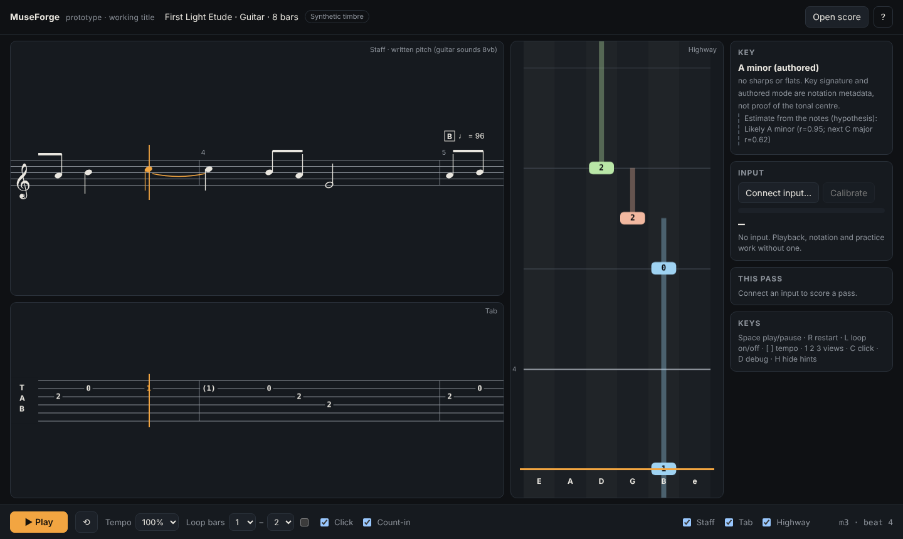
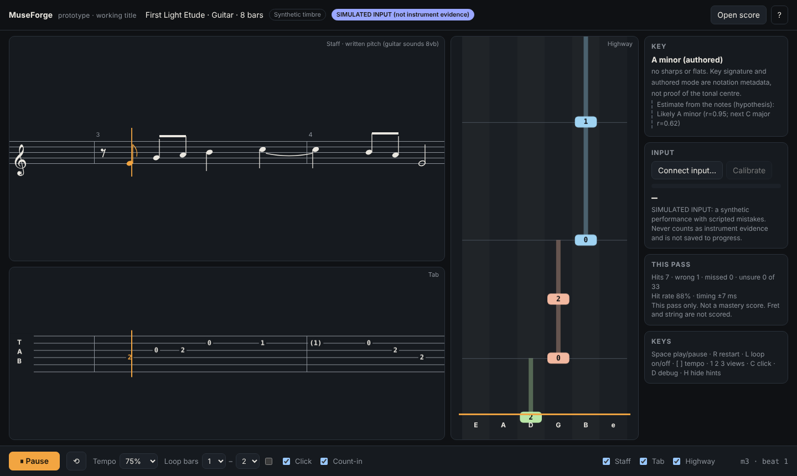
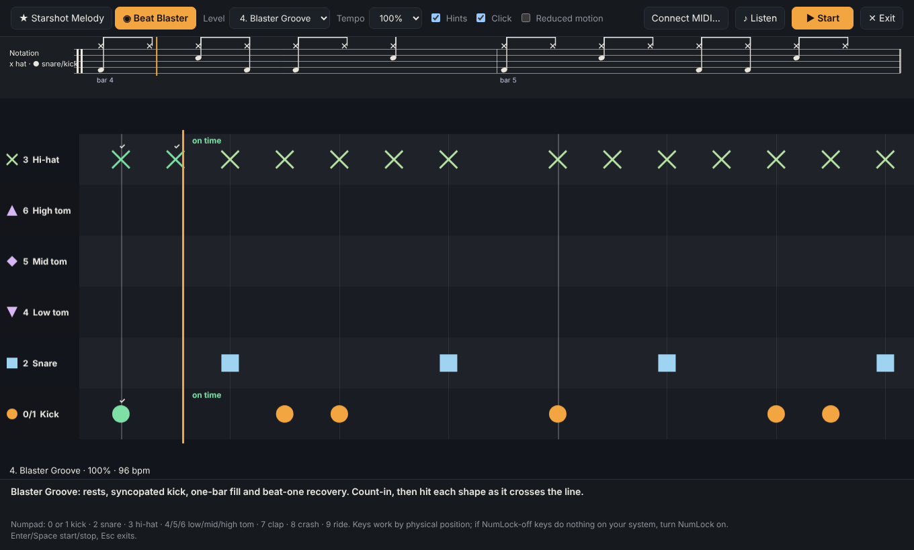

# MuseForge

An educational music platform for learning a real instrument: notation you can
read, practice that responds to what you actually play, and games that make
repetition survive the first month.

**Status: early prototype.** The core engine is verified in a Linux cloud
environment using synthetic signals. It has **not** yet been run on Windows or
with a real guitar in the loop, and nothing here is a shipped product.

This repository is a **public project showcase**. The implementation lives in a
private repository and is not published here. See [Licensing](#licensing).

---

## The idea

Most practice software forces a choice: a notation viewer that cannot hear you,
or a rhythm game that teaches a controller-shaped version of music. MuseForge
keeps the musical object at the centre and derives every view from it.

A single event timeline and a single audio clock drive staff notation, tab and
the game highway together. Notes come from notation, audio is synthesized from
that notation, and what you play is scored against the same timeline.

## Instruments

Presented deliberately: this is what exists, and what is planned.

| Instrument | State |
|---|---|
| **Guitar** | The only instrument implemented. Monophonic pitch and onset detection from device audio, with explicit uncertainty and a calibration routine. Fret and string are **not** inferred. |
| **Piano** | Planned. Keyboard-range and polyphonic scoring are unsolved here, and no piano support is claimed. |
| **Drums** | Partially explored through a rhythm minigame using PC keys; real drum-pad and MIDI input is planned. |
| **Vocals** | Planned. Pitch-tracking for voice is not implemented and not claimed. |
| **Other instruments** | Planned, in the sense that nothing about the design forbids them. Not started. |

## What is verified

- MusicXML import into a canonical model, with tab/octave validation and a
  stable arrangement hash.
- Synthesized guitar plus click and count-in, offline and deterministic.
  Tempo from 50–100 % without pitch change.
- Staff, tab and highway synchronized to the audio clock (measured within
  2.5 ms, with no drift across loops).
- A/B bar loops with clean seams, keyboard shortcuts, toggleable views and
  hints, light and dark themes, and a phone layout.
- Device input through an AudioWorklet pitch/onset detector into live scoring:
  hit, wrong pitch, octave, uncertain, missed — with a calibration routine.
- Authored key versus a labelled key hypothesis, with abstention instead of a
  guess.
- Settings, resume position, calibration and run history persisted locally.

All of the above was verified with **synthetic** signals in a cloud environment.
That is a meaningful bar for the engine and a weak bar for the instrument.

## Minigames

Games that need no instrument, so a learner can build rhythm and pitch-recognition
fluency away from the guitar:

- **Starshot Melody** — play the star's note on the keyboard (C4–E5).
- **Beat Blaster** — kick, snare, hi-hat and toms on the numpad, with per-pad
  key rebinding.
- **Duet** — two players at one keyboard, one clock, separate scores.
- **Hints off** — play from memory and be scored separately from aided runs.

PC-keyboard results are practice only and are explicitly **not** treated as
real-instrument evidence.

## The long-term vision: Session Mode

Session Mode is the direction the architecture is being built toward: a shared,
scheduled practice session where a teacher and a student — or two learners —
work from the same notation and the same clock, with each participant's input
scored separately and visible to the other.

It is a **design goal**, not a feature. It requires real-instrument validation,
multi-peer time synchronization and server-side session state, none of which
exist yet. It is documented publicly because it explains why the engine is
structured around one clock and one timeline in the first place.

## What does not work yet

Real-instrument validation, chords and bends, 6/8, tuplets, repeats, a desktop
shell, Steam packaging, and recorded backing tracks.

## Intended audience

Self-taught guitarists in their first two years, music teachers looking for
practice tooling that reports uncertainty honestly, and developers interested in
music-education interfaces.

## Related projects

Other projects in this portfolio are listed on the
[portfolio profile](https://github.com/jesusrodriguez1990z).

## Licensing

This is a **showcase repository** containing documentation and screenshots only:

- No implementation source code is published here.
- **No licence is granted**, and none is implied, for the private implementation.
  There is no `LICENSE` file, deliberately.
- No third-party song files, arrangements, recordings or copyrighted music
  assets are published or redistributed here. The example exercise shown is
  original to this project, and the audio is synthesized from its notation.

See [CHANGELOG.md](CHANGELOG.md) for the public milestone record.
